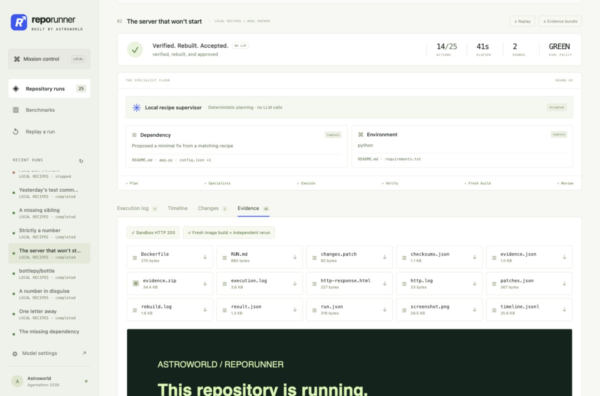

# RepoRunner

**Make it run. Prove it works.** Built by Astroworld for Agentathon 2026.

A local repository repair application with Python, Node/static HTML, Go, Rust, Maven Java,
and .NET runtime profiles: separate supervisor and worker
models, parallel tasks, real Docker execution, recursive feedback, independent verification,
fresh rebuilds, human approval, and downloadable evidence. Includes a responsive dashboard,
CLI, replay, SQLite recipe memory, and a measured local evaluation suite.



## Start

Requires uv, Python 3.11+ (uv can manage it), and a running Docker engine or Docker Desktop.

```sh
uv sync --frozen --extra test --extra screenshots
uv run --frozen --extra screenshots reporunner serve
```

Open **http://127.0.0.1:8765**. On macOS, double-click `Launch RepoRunner.command`.
`make setup`, `make start`, `make test`, and `make evaluate` provide the same workflows.

Pre-pull `python:3.11-slim` and `node:20-slim` for offline use. Screenshot capture uses installed
Google Chrome on macOS; elsewhere run `uv run --extra screenshots playwright install chromium`.
Without a usable browser, real HTTP verification works and the screenshot is omitted.

## Two honest execution modes

**Local recipes** needs no API key. It is a deterministic engine, explicitly **not an LLM**.
The bundled repositories really fail, get patched, install dependencies, run original tests,
and rebuild in Docker. The old `reporunner-demo` is retained as a labelled mock controller
example; use the dashboard examples for real Docker execution.

**Live AI** uses your high-capability OpenAI-compatible supervisor and separate open-source
worker endpoint. Enter endpoint base URLs, model IDs, and keys in Model settings. Providers
must support chat-completions JSON mode. Settings stay in server memory and clear on restart;
keys are never returned to the UI. Saving settings is not a connection test.

You can instead configure the environment before starting the app:

```text
SUPERVISOR_BASE_URL=https://your-provider.example/v1
SUPERVISOR_MODEL=your-supervisory-model
SUPERVISOR_API_KEY=...
WORKER_BASE_URL=http://127.0.0.1:8001/v1
WORKER_MODEL=your-open-source-model
WORKER_API_KEY=...
```

Optional per-role overrides use `WORKER_DEPENDENCY_MODEL`, `WORKER_DEPENDENCY_BASE_URL`, and
`WORKER_DEPENDENCY_API_KEY`, likewise for repository/environment/configuration/build/test.
The app does not automatically source `.env`; `.env.example` documents variables. Token
usage is recorded when the provider reports it. No price or model performance is invented.

## Run, inspect, approve

Paste a public `https://github.com/owner/repository` URL or choose a broken example.
GitHub REST quota failures fall back to Git metadata and, if necessary, a content-addressed
archive. Source bundles contain the exact candidate and its content snapshot hash.

Package network access defaults **off**. Examples work offline once images are available.
Enable package access only for trusted repositories: Docker bridge networking can reach
networks accessible to the host; it is not a restricted Internet-only egress proxy.

Watch actual logs, scoped workers, patch conflicts, repairs, and checks. Inspect Changes and
Evidence before accepting. A missing credential pauses the run; provision its value locally
and return an opaque resource reference. Values stay in execution memory, are not sent to
models, and are cleared after cleanup. Known supplied values are redacted from returned
command output; general secret detection in arbitrary source/logs is not guaranteed.

GREEN requires actual independent tests or HTTP 200, a fresh image build and independent
rerun, no failed required checks, matching snapshot identity, Dockerfile/RUN.md evidence,
and final approval. Startup alone is insufficient. Original test-file patches are rejected
and test files are fingerprinted. Stops and failures also receive an evidence/report bundle.

## Repository capacity

Large repositories are streamed through temporary files instead of buffered as whole archives.
Defaults are 256 MiB compressed download, 1 GiB expanded tar, 768 MiB retained source,
256 MiB per file, and 50,000 archive members. Model context remains separately bounded.

Override these positive integer environment variables **before starting** RepoRunner:

| Variable | Default | Meaning |
| --- | --- | --- |
| `REPORUNNER_MAX_DOWNLOAD_MB` | 256 | Compressed repository download |
| `REPORUNNER_MAX_ARCHIVE_MB` | 1024 | Entire expanded archive, including tar metadata |
| `REPORUNNER_MAX_SOURCE_MB` | 768 | Extracted source files |
| `REPORUNNER_MAX_FILE_MB` | 256 | Individual source file |
| `REPORUNNER_MAX_MEMBERS` | 50000 | Archive files and directories |
| `REPORUNNER_WORKSPACE_MB` | 1024 | Container workspace tmpfs capacity |
| `REPORUNNER_MEMORY_MB` | 2048 | Container RAM ceiling |
| `REPORUNNER_TMP_MB` | 192 | Container temporary-file tmpfs capacity |

`_MB` settings use MiB (1,048,576 bytes). Leave workspace room for dependencies/build output;
RAM must exceed the combined workspace and temporary tmpfs caps to leave runtime headroom.
Source/file/archive settings must be consistent. Invalid settings fail with an explicit error;
zero does not disable a limit. `/api/health` reports active capacities. Run budgets remain
separate from repository size settings. `.env` files are not automatically loaded.

## CLI and replay

```sh
uv run reporunner run --fixture python-dependency
uv run reporunner run https://github.com/owner/repository --mode live
uv run reporunner run https://github.com/owner/repository --mode live --network
uv run --extra screenshots reporunner evaluate
uv run reporunner evaluate --public --mode live --network
```

CLI runs request interactive approval. Export a run's JSONL timeline and import it under
Replay a run to play, pause, change speed, or scrub. Replay executes no commands and calls
no models. Label recordings as replay during demonstrations.

## Actual evaluation

The recorded Docker suite repaired **7/7 fixable fixtures** and recognized **3/3 deliberate
resource blockers**. Each repair passed original tests or HTTP, then a fresh-container check.
The sum of recorded run times was **104.57 seconds** on this machine. This is a **curated local
suite, not a public GitHub benchmark or general repair-rate estimate**.

The evaluator automatically accepts verified known fixtures and declines resource blockers
under an explicit test policy. That is not a senior human review. Normal runs require final
interactive approval. Inspect [recorded results and ten evidence bundles](benchmark/README.md).
The public test-set manifest has no unmeasured suite scores. Bottle was additionally tested from GitHub: its 363 original tests and fresh-container rerun passed, and final acceptance was exercised during development QA. No repair was needed for that repository. Rerun the local evaluation in the UI
or CLI. A fresh run can produce different timings.

## Project map

| Directory | Responsibility |
| --- | --- |
| `backend/orchestrator/` | Supervisor, model routing, parallel workers, aggregation, budgets, approvals, memory |
| `backend/sandbox/` | Repository acquisition, snapshots, atomic patch validation, Docker execution |
| `backend/verifier/` | Independent original test discovery and actual nonzero-test checks |
| `backend/evidence/` | Dockerfile, RUN.md, logs, screenshot, checksums, source/evidence ZIP |
| `backend/app/` | Integrated local API, run lifecycle, sessions, resource provisioning, CLI |
| `frontend/` | Dashboard, workers, logs, diffs, approvals, evidence, replay, benchmarks |
| `contracts/` | Generated draft shared JSON schemas |
| `fixtures/`, `benchmark/` | Small real broken repos, evaluator, measured results, captured evidence |
| `tests/` | Controller, schemas, patch/archive safety, API, verification and resource tests |

See [system design](architecture/SYSTEM_ARCHITECTURE.md), [security boundaries](architecture/SECURITY.md),
[integration](architecture/INTEGRATION_PLAN.md), and [the three-minute demo](docs/DEMO.md).

## Scope and operation

This release recognizes root manifests for Python, Node, Go, Rust, Maven Java, and .NET,
plus static HTML sites. Original tests must report a nonzero test count; static sites can
be verified by an actual HTTP response and fresh rebuild. The runtime smoke results in
`benchmark/results/runtime-smoke.json` report actual checks of small local cases, not a
public-repository repair benchmark. HTTP probing uses sandbox port 8000. GPU provisioning,
private registries, arbitrary monorepos, Gradle, Compose stacks, and native/system package
installation still need human intervention or another adapter. No universal repository success is promised.

Before proposing a repair, the controller runs detected original tests as a baseline.
Manifest-derived dependency setup is scheduled deterministically. Scoped workers can read
files outside the first context batch using exact paths from the supplied file inventory.
Every finished run includes `REPORT.md` with commands, errors, model usage, patches, checks,
and its unresolved blocker. Token cost is not invented when provider pricing is unavailable.
Command output is bounded, with the beginning and ending retained and an explicit
truncation marker. All action events remain ordered in the downloadable timeline.
Model calls retry transient transport/server/rate-limit failures and invalid structured
responses up to three attempts. Set `REPORUNNER_MODEL_TIMEOUT_SECONDS` (default 180,
maximum 600) before startup; the overall run deadline still bounds those retries.

The dashboard selects **Extended repair** for up to 100 actions / 30 minutes. Uncheck it
for 25 actions / 10 minutes; CLI/API defaults remain 25 / 600 seconds.
**Continue from checkpoint** copies the saved candidate into a new isolated run,
retains previous failure context, and records its parent run. It does not restore credentials
or a running container. Package network access is an explicit choice on each attempt.
CLI budgets can be set with `--steps` (maximum 250) and `--seconds` (maximum 3600), and
`--resume RUN_ID` continues a saved candidate. Repeated identical executable plans are
rejected before execution; extended runs get additional replanning attempts.

Use **one local server process**. It binds to loopback with a local HTTP-only SameSite session,
Host/Origin checks, and guarded writes. It is not a public multi-tenant service. SQLite saves
results, events, and recipes; active tasks and approval futures are memory-only. A restart
marks interrupted runs stopped. Durable active-run recovery and distributed queues are not included.

Containers have no host mounts or Docker socket; they use an unprivileged user, read-only
root, bounded tmpfs, dropped capabilities, no-new-privileges, and PID/CPU/memory/time limits.
The host orchestrator controls Docker and must run in a trusted account. Docker is not an
absolute defense against kernel or engine vulnerabilities.

Data defaults to `.reporunner/`. Set `REPORUNNER_DATA` (or CLI `--data`) to change it.
`REPORUNNER_PYTHON_IMAGE`, `REPORUNNER_NODE_IMAGE`, `REPORUNNER_GO_IMAGE`,
`REPORUNNER_RUST_IMAGE`, `REPORUNNER_JAVA_IMAGE`, and `REPORUNNER_DOTNET_IMAGE`
override default runtime tags. Images
are pinned to their available registry digest and sanity checked before use; models cannot
execute host Docker commands or independently change the runtime image.

## Checks

```sh
uv run --extra test pytest -q
node --check frontend/app.js
uv run reporunner-contracts
```

Schemas remain draft shared contracts, ready for team review. CI detects drift. Live model
reasoning/provider compatibility still needs validation with your configured endpoints;
no live model keys were supplied for this build. No competition result, hosted deployment,
or GitHub push is claimed.
