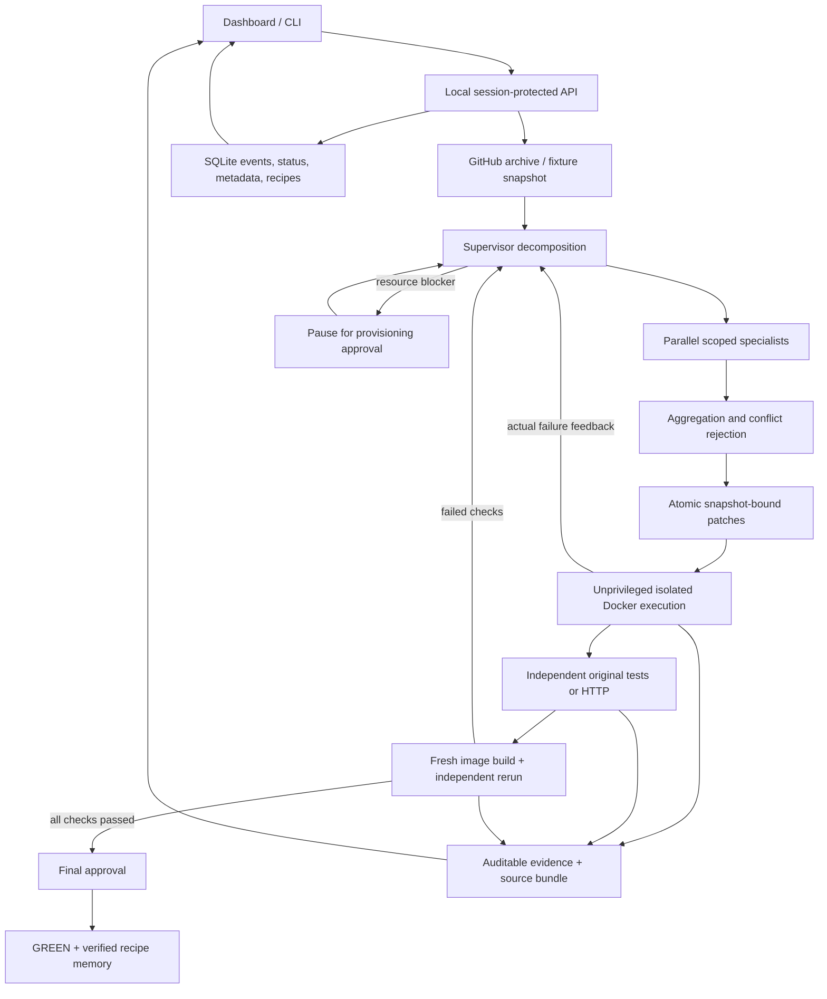

# Integrated system architecture

All three originally assigned layers are implemented: Mudit's intelligence, Madhav's
execution/verification/evidence, and Likith's interface. The boundaries remain explicit
modules inside one local app.

Live AI uses separate chat-compatible supervisor and worker endpoints. Local recipes uses
an explicitly labelled deterministic engine. Both call the same actual sandbox and verifier.
Neither engine can set its own grade.

The entire run, including preparation and approval waits, is capped at 600 seconds. Each
model/worker call, command, and verification charges an action (maximum 25). Cleanup has
a small additional grace period. Repeated errors require a changed command/patch strategy
on occurrence two and stop on occurrence three. Action IDs deduplicate live execution writes.

Candidates live in bounded host-tracked source directories. Workers only propose diffs;
patches are validated against exact content snapshots. Original tests are protected.
Repository code executes in Docker without host mounts. A source patch recreates the
sandbox, clearing command-side mutations. Fresh builds use host-tracked source, not the
potentially modified running container.

One local process supports three active runs. SQLite persists status, metadata, ordered
events, and recipes. Model settings and provisioned values are memory-only. Restart stops
interrupted records rather than silently replaying external effects. Evidence and sources
persist under the selected data directory.

The integrated app uses the local execution adapter. The standalone supervisor API and
HTTP execution adapter remain available for a later split-service deployment.
